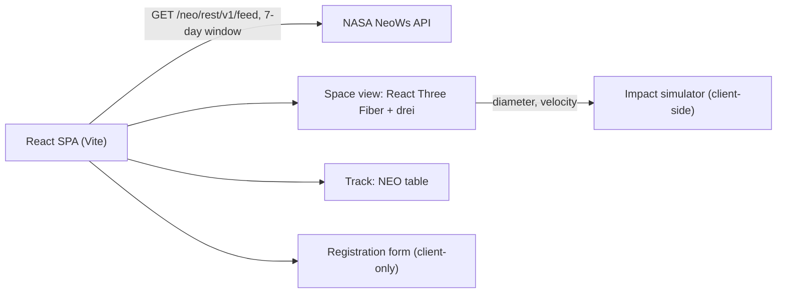

# Meteor Madness (nasa-meteor-project)

An interactive 3D explorer for near-Earth asteroids, with an impact simulator. Built with React, React Three Fiber, and NASA's NeoWs (Near Earth Object Web Service) API.


**Live demo:** [nasa-meteor-project.vercel.app](https://nasa-meteor-project.vercel.app)

## Overview

Meteor Madness pulls the next 7 days of near-Earth objects (NEOs) from NASA's NeoWs feed and shows them orbiting a textured 3D Earth. Click an asteroid to see its size, speed, miss distance, and a simple risk rating. From there you can send it to the impact simulator, browse every upcoming approach in a table, or open a hackathon registration page. That page refers to the NASA Space Apps Challenge 2025 (October 3-4, University of Dubai).

## Features

- **Space view** (`/`, `/space`): a rotating Earth with color, bump, and specular maps, a 6,000-star background, and orbit controls. Each NEO in the feed appears as a textured asteroid orbiting Earth and is highlighted on hover or selection.
- **Asteroid card**: shows the name, mean estimated diameter, relative velocity, miss distance (AU), risk level, and a generated description. **Simulate Impact** passes the asteroid's diameter and velocity to the simulator.
- **Risk rating**: asteroids that are not potentially hazardous get *None*. Potentially hazardous ones get *Medium*, raised to *High* if wider than 500 m and passing closer than 0.05 AU, or lowered to *Low* if under 100 m.
- **Track** (`/track`): a table of NEOs sorted by close-approach time, with name, approach date, diameter, velocity, miss distance (km), and hazardous flag.
- **Impact simulator** (`/impact`): sliders for diameter (10-5000 m) and velocity (1-100 km/s) produce impact energy, crater diameter, blast radius, and a severity level (*Low*, *Regional*, *Global*, *Catastrophic*). The formulas are simplified for demonstration and are not calibrated physics.
- **Simulated hazard alert**: if you "subscribe" a phone number and the result is *Catastrophic*, a mock SMS alert appears in the UI. No message is actually sent.
- **Registration** (`/registration`): a hackathon sign-up form that only logs to the browser console. There is no backend.

## How It Works



`src/nasa.js` requests the feed from today through 7 days ahead and flattens the per-date `near_earth_objects` map into a single list. The Space and Track views both use it.

## Tech Stack

- **UI:** React 19, React Router 6, inline styles
- **3D:** Three.js, `@react-three/fiber`, `@react-three/drei` (`OrbitControls`, `Stars`, `useTexture`)
- **Data:** NASA NeoWs feed API
- **Tooling:** Vite 7, ESLint 9
- **Hosting:** Vercel (`vercel.json` builds the `meteormadness/` app)

## Getting Started

**Prerequisites:** Node.js and npm.

```bash
git clone https://github.com/4waiz/nasa-meteor-project.git
cd nasa-meteor-project/meteormadness
npm install
npm run dev          # starts the Vite dev server
```

Other scripts:

```bash
npm run build        # production build to meteormadness/dist
npm run preview      # preview the production build
npm run lint         # ESLint
```

## Configuration

Create `meteormadness/.env.local`. Files matching `*.local` are already ignored by `meteormadness/.gitignore`.

```env
VITE_NASA_API_KEY=your-nasa-api-key
```

| Variable | Required | Purpose |
| --- | --- | --- |
| `VITE_NASA_API_KEY` | No | NeoWs API key. Falls back to NASA's rate-limited `DEMO_KEY`. Get a free key at [api.nasa.gov](https://api.nasa.gov). |
| `VITE_CLERK_PUBLISHABLE_KEY` | No | Only needed if you re-enable the Clerk sign-in page (`src/Authentication.jsx`), which the current `App.jsx` does not route to. |

`VITE_*` variables are embedded in the client bundle, so use only keys that are safe to expose.

## Project Structure

```
nasa-meteor-project/
├── vercel.json                  # Vercel install/build/output settings for meteormadness/
└── meteormadness/
    ├── public/textures/         # Earth (map, bump, specular) and asteroid textures
    ├── src/
    │   ├── App.jsx              # routes: /, /space, /track, /impact, /registration
    │   ├── Space.jsx            # 3D scene, asteroid cards, navigation buttons
    │   ├── Track.jsx            # NEO tracking table
    │   ├── Impact.jsx           # impact simulator and simulated alert
    │   ├── Registration.jsx     # hackathon registration form
    │   ├── nasa.js              # NeoWs feed client
    │   ├── Authentication.jsx   # Clerk sign-in/sign-up (currently not routed)
    │   └── assets/data/data.js  # sample NeoWs response (not imported)
    ├── package.json
    └── vite.config.js
```

---

Built by [Awaiz Ahmed](https://github.com/4waiz)
